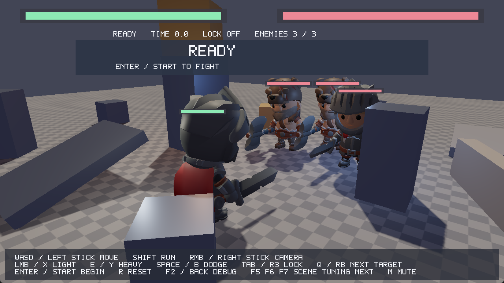

# Hue

A third-person combat game runtime written from scratch in C++20 and Vulkan,
built in 20 weeks before GTA 6 ships.



*The `gauntlet` scene: one player against three enemies, shadow-mapped sun,
static props with collision. Characters and animations are KayKit (CC0).*

## What's in it

- **Engine core.** A tagged heap, frame arenas and pool allocators that
  account for every engine allocation, a sparse-set ECS, a job system, and no exceptions or RTTI
  in engine code.
- **Rendering.** A Vulkan 1.3 renderer with GPU skinning, a lit pass, a 2048²
  shadow map with PCF for the sun, point lights, and shader hot reload that
  validates a new shader before swapping it in.
- **Animation and combat.** Skeletal animation sampling and blending, clip
  events that drive attack windows and dodge invulnerability, light and heavy
  attacks, lock-on with target switching, and enemy AI for one player against
  up to seven enemies.
- **Physics and audio.** Jolt character controllers and static collision;
  twelve procedural sound effects with distance attenuation and panning,
  through Hue's own WAV parser.
- **Data-driven scenes.** Actors, props, lights and the sun come from
  validated scene files that can be swapped at runtime.
- **Security-minded loading.** Every byte read from a file is treated as
  untrusted. The glTF, animation-event, scene, tuning, shader-contract and WAV
  parsers are bounded, validated and fuzzed under ASan and UBSan. Fuzzing
  found two real bugs in third-party parsing code (misaligned glTF accessors
  in cgltf, a null zero-length `memcpy` in stb_image); both are fixed with
  regression tests, and a 24-target-hour campaign afterwards found nothing.
  See the [threat model](docs/threat-model.md) and
  [fuzz campaign log](docs/fuzz-campaign.md#run-log).
- **Tooling.** In-game combat and memory diagnostics, Tracy profiling, per-fight
  telemetry, and a packager that produces a verified, hash-manifested ZIP.

186 automated tests pass on Windows in Release, and 185 under AddressSanitizer.
What has and has not been checked is listed under [Status](#status).

## Playing the encounter

Run `build/windows-msvc/game/Release/hue.exe` after building (Linux:
`build/linux-clang/game/hue`). Models/events and shaders stage beside the executable.

| Action | Keyboard / mouse | Gamepad (Xbox-style mapping) |
|---|---|---|
| Start; return to ready after a result | Enter | Start |
| Reset to ready at any time | R | Start after a result |
| Move; run | WASD; Shift | Left stick, analog speed |
| Orbit camera | Hold RMB and move mouse | Right stick |
| Light / heavy attack | LMB / E | X / Y |
| Dodge | Space | B |
| Toggle lock-on | Tab | Right-stick click |
| Next lock-on target | Q | Right bumper |
| Cycle game, combat and memory diagnostics | F2 | Back |
| Stage scene / tuning edits; apply on reset | F5 / F6; R | — |
| Stage the next shipped scene; mute | F7; M | — |
| Debug fly camera; quit | F1; Escape | — |

Attack windows and dodge invulnerability follow clip events. Simultaneous lethal
hits trade and resolve to player defeat. The result stops gameplay while death
animation continues. Restart reuses loaded assets and controllers.

Scenes live in `assets/config` and are chosen by name: `hue --scene gauntlet`
starts the three-enemy scene with props. A scene file lists the player and up to
seven enemies, static box props, point lights and the sun; see
[the scene format and its validation](docs/threat-model.md#scene-configuration).
`--no-audio` runs without opening an output device.

`hue --encounter-smoke --require-renderer` runs 20 scripted reset/outcome cycles
with real rendering. It injects lethal damage to exercise both results and is
not a substitute for a human playtest or a combat-balance evaluation.

## Building

Requirements: CMake ≥ 3.28, a C++20 compiler (MSVC 2022+ or Clang), Ninja on Linux.

```
cmake --preset windows-msvc      # or linux-clang
cmake --build --preset windows-release
ctest --preset windows-release
```

Sanitized build (ASan on MSVC, ASan+UBSan on Clang):

```
cmake --preset windows-msvc-asan   # or linux-clang-sanitized
cmake --build --preset windows-asan
ctest --preset windows-asan
```

## Local review package

Windows packaging requires Python 3.11+ and the existing Release build toolchain.
Choose a fresh output directory; the tool refuses to overwrite a package:

```sh
python tools/package.py --build build/windows-msvc --output build/packages/hue-review --require-clean
python tools/package.py --verify build/packages/hue-review
python tests/package_smoke.py build/packages/hue-review
```

The adjacent ZIP includes the executable, seven compiled shaders, models/events,
sound effects, scene/tuning data, MSVC Release runtime DLLs, controls and dependency notices.
The manifest records file hashes and source revision/dirty state. Extract the
whole ZIP, then run `hue.exe`; no compiler or Vulkan SDK is needed on the target,
but Windows x64, SSE4.2 and a Vulkan 1.3 graphics driver are required.

Capture optional local reports with `hue.exe --telemetry C:/writable/fights.jsonl`;
summarize with `python tools/fight_report.py C:/writable/fights.jsonl`. See
[telemetry and evidence limits](docs/week15.md). Runtime files and config are
executable-relative, independent of the launch directory.

## Status

Hue is a portfolio project, verified on one Windows machine (RTX 5090, MSVC).
It has not been checked by outside playtesters, on a physical gamepad, on a
clean machine or on Linux, and multi-enemy fights are not balanced. Fuzzing
ran four hours per target with no finding, short of the 24–48 hours first
planned. Details are in [candidate scope, verification and
risks](docs/release-candidate.md) and the [development
timeline](docs/timeline.md).

Hue has no declared project-wide licence; dependency and asset notices do not
choose one for it. Nothing is published by the commands above.

## Layout

```
/engine
  /core        # platform, memory, math, containers, jobs, log
  /render      # vulkan backend, shadow + lit passes, materials, skinning
  /anim        # skeletal animation runtime: sampling, blending, events
  /audio       # bounded WAV parsing, fixed-voice mixer, output device
  /combat      # shared combat logic, hit volumes, enemy AI
  /ecs         # sparse-set ECS
  /physics     # jolt integration layer
  /asset       # gltf import (mesh+skin+anim), shader compile, hot reload
/game          # actor roster, encounter lifecycle, scenes, HUD, audio events, diagnostics
/tests         # doctest suites
/tools         # scripts: shader compile, fuzz harnesses (/tools/fuzz)
/docs          # public timeline, devlog drafts, threat-model.md
```

See [docs/timeline.md](docs/timeline.md) for the week-by-week development timeline and [docs/threat-model.md](docs/threat-model.md) for the living threat model.
